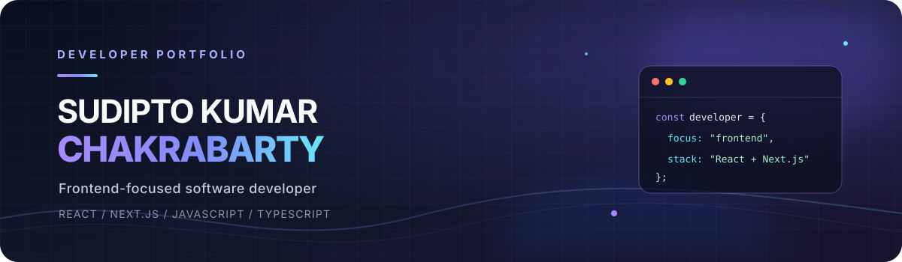
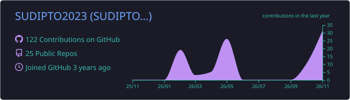
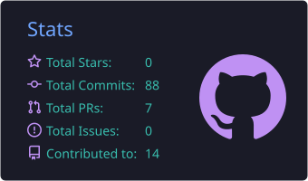
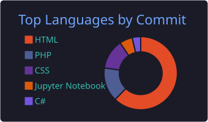
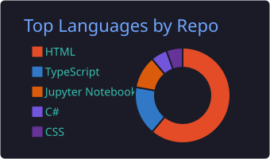

  
  &nbsp;
  
  &nbsp;
  
  &nbsp;
  

  <a href="https://sudipto-kumar-chakrabarty.netlify.app/">Portfolio</a> &nbsp;·&nbsp;
  <a href="https://www.linkedin.com/in/sudipto333/">LinkedIn</a> &nbsp;·&nbsp;
  <a href="https://github.com/SUDIPTO2023">GitHub</a> &nbsp;·&nbsp;
  <a href="mailto:skchakrabarty2020@gmail.com">Email</a>

<h2 align="center">SYSTEM STATUS</h2>

<table>
  <tr>
    <td align="center"></td>
    <td align="center"></td>
    <td align="center"></td>
  </tr>
  <tr>
    <td align="center"></td>
    <td align="center"></td>
    <td align="center"></td>
  </tr>
</table>

<h2 align="center">ABOUT ME</h2>

  
    
  <i>Clean interfaces on top. Solid fundamentals underneath.</i>

 

CSE undergraduate at American International University-Bangladesh (AIUB) with a CGPA of 3.77/4.00. Currently working as a Software Engineer Intern, focusing on MERN Stack Development. Interested in Artificial Intelligence, Machine Learning, Deep Learning, and Computer Vision, with a strong passion for research, software engineering, problem-solving, and exploring emerging technologies.

<table width="86%">
  <tr>
    <td width="50%" valign="top">
      <b>Role</b> 
      Frontend-Focused Software Developer
        
      <b>Primary Stack</b> 
      <code>React.js</code> <code>Next.js</code> <code>TypeScript</code> <code>JavaScript</code>
        
      <b>Programming Languages</b> 
      <code>C</code> <code>C++</code> <code>Python</code> <code>Java</code> <code>C#</code>
    </td>
    <td width="50%" valign="top">
      <b>Platform</b> 
      <code>.NET</code>
        
      <b>Currently Learning</b> 
      React.js, Next.js &amp; TypeScript in depth 
      Backend development &amp; .NET
        
      <b>Contact</b> 
      <a href="mailto:skchakrabarty2020@gmail.com">skchakrabarty2020@gmail.com</a> 
      <a href="https://sudipto-kumar-chakrabarty.netlify.app/">Portfolio</a> · <a href="https://www.linkedin.com/in/sudipto333/">LinkedIn</a>
    </td>
  </tr>
</table>

<h2 align="center">TECHNOLOGY STACK</h2>

<table width="86%">
  <tr>
    <td colspan="2" align="center">
      <b>FRONTEND · PRIMARY FOCUS</b>
        
      
    </td>
  </tr>
  <tr>
    <td align="center" width="62%">
      <b>PROGRAMMING LANGUAGES</b>
        
      
    </td>
    <td align="center" width="38%">
      <b>FRAMEWORK &amp; PLATFORM</b>
        
      
    </td>
  </tr>
</table>

<h2 align="center">SELECTED PROJECTS</h2>

<table>
  <tr>
    <td width="50%" valign="top">
      <h3><a href="https://github.com/SUDIPTO2023/Medicine-Finder-System">Medicine Finder System</a></h3>
      
A C# Windows Forms application for searching medicines by name and location. It includes role-based access for administrators, pharmacy managers and clients, plus account-recovery features.

      

      <a href="https://github.com/SUDIPTO2023/Medicine-Finder-System">View repository →</a>
    </td>
    <td width="50%" valign="top">
      <h3><a href="https://github.com/SUDIPTO2023/1st-assignment-programming-hero">Programming Hero — Web Project</a></h3>
      
A public web-development project with a published GitHub Pages preview.

      

      <a href="https://sudipto2023.github.io/1st-assignment-programming-hero/">View live project →</a>
    </td>
  </tr>
</table>

  <a href="https://github.com/SUDIPTO2023?tab=repositories">Explore all repositories</a>

<h2 align="center">GITHUB ANALYTICS</h2>

 

Cards are generated from real GitHub data by GitHub Actions and refresh automatically every day.

<h2 align="center">CONTRIBUTION ACTIVITY</h2>

  <picture>
    <source media="(prefers-color-scheme: dark)" srcset="https://raw.githubusercontent.com/SUDIPTO2023/SUDIPTO2023/output/github-snake-dark.svg">
    <source media="(prefers-color-scheme: light)" srcset="https://raw.githubusercontent.com/SUDIPTO2023/SUDIPTO2023/output/github-snake.svg">
    
  </picture>

<h2 align="center">CURRENT DIRECTION</h2>

<table width="86%">
  <tr>
    <td align="center" width="25%"><b>Deepening</b> React.js, Next.js and TypeScript</td>
    <td align="center" width="25%"><b>Building</b> Polished, responsive frontend experiences</td>
    <td align="center" width="25%"><b>Strengthening</b> Backend fundamentals and .NET</td>
    <td align="center" width="25%"><b>Practising</b> Problem-solving through software projects</td>
  </tr>
</table>

<h2 align="center">CONNECT</h2>

<table>
  <tr>
    <td align="center" width="200">
      <a href="https://sudipto-kumar-chakrabarty.netlify.app/"> <b>Portfolio</b></a> Personal website
    </td>
    <td align="center" width="200">
      <a href="https://www.linkedin.com/in/sudipto333/"> <b>LinkedIn</b></a> sudipto333
    </td>
    <td align="center" width="200">
      <a href="https://github.com/SUDIPTO2023"> <b>GitHub</b></a> SUDIPTO2023
    </td>
    <td align="center" width="260">
      <a href="mailto:skchakrabarty2020@gmail.com"> <b>Email</b></a> skchakrabarty2020@gmail.com
    </td>
  </tr>
</table>

  

